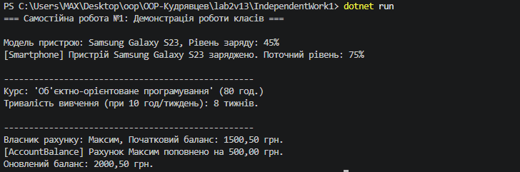

# Самостійна робота №1: Базовий синтаксис C# і оголошення класів

## Короткий опис
У цій самостійній роботі реалізовано 3 власні класи для моделювання об'єктів реального світу:
* **Smartphone:** моделює пристрій із полем заряду батареї, властивістю тільки для читання `Model` та методом зарядки `ChargeBattery()`.
* **Course:** представляє навчальний курс, містить кількість годин та метод `CalculateWeeksCount()` для обчислення тривалості навчання.
* **AccountBalance:** реалізує банківський рахунок із приватним балансом, можливістю перевірки та методом поповнення `Deposit()`.

## Результат виконання програми

## Відповіді на контрольні запитання
1. **Мінімальні елементи класу у цьому завданні:**
   Клас повинен містити мінімум 2 приватних поля, принаймні 1 публічну властивість (з get/set або read-only), конструктор для ініціалізації полів та щонайменше 1 метод із логікою або обчисленнями.

2. **Чому поля доцільно робити приватними:**
   Це забезпечує принцип **інкапсуляції**. Приватні поля захищають дані об'єкта від неузгоджених змін із зовнішнього коду. Доступ через властивості дозволяє додавати валідацію даних (наприклад, обмеження рівня заряду від 0 до 100%).

3. **Призначення конструктора та зв'язок зі станом об'єкта:**
   Конструктор викликається під час створення екземпляра класу (`new`) та ініціалізує початковий стан об'єкта (задає початкові значення його полів).

4. **Демонстрація коректності роботи у Main:**
   У методі `Main` створюються екземпляри класів через `new` з передачею тестових даних, викликаються їхні методи, а результати обчислень та зміни стану виводяться в консоль.

## Висновок
Під час виконання самостійної роботи закріплено навички оголошення класів, використання приватних полів, публічних властивостей, конструкторів та методів у мові C#.