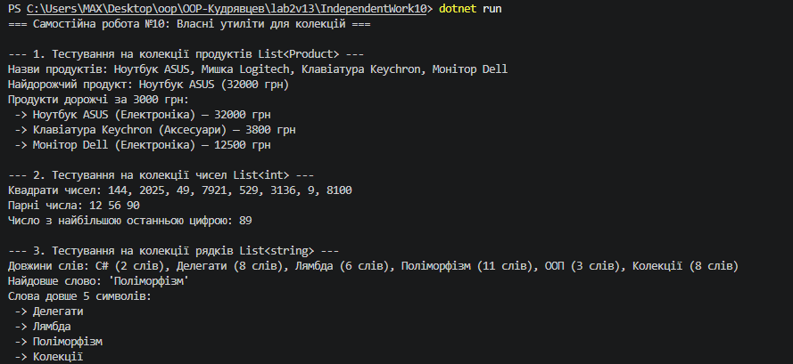

# Самостійна робота №10: Делегати й лямбда-вирази: власні утиліти для колекцій

## Короткий опис
У цій самостійній роботі реалізовано статичний клас утиліт `CollectionUtils`, який містить узагальнені методи для маніпуляції колекціями за допомогою делегатів та лямбда-виразів:
* **`Map<TSource, TResult>`:** перетворення кожного елемента колекції за допомогою `Func<TSource, TResult>` (аналог LINQ `Select`).
* **`MaxBy<T, TKey>`:** пошук елемента з максимальним ключем за допомогою `Func<T, TKey>` де `TKey : IComparable<TKey>`.
* **`Filter<T>`:** фільтрація елементів за допомогою `Predicate<T>` (аналог LINQ `Where`).
* **`ForEach<T>`:** виконання дії для кожного елемента за допомогою `Action<T>`.

## Результат виконання програми

---

## Звіт: Переваги делегатів та порівняння з LINQ

1. **Чому делегати корисні для створення утиліт:**
   Делегати дозволяють передавати алгоритм або дію як параметр у метод. Це відокремлює логіку обходу колекції від конкретної операції над елементом (принцип OCP — Open/Closed Principle).

2. **Як лямбда-вирази спрощують виклик цих методів:**
   Лямбда-вирази (`p => p.Price > 1000`) дозволяють записувати логіку анонімних функцій безпосередньо за місцем виклику без створення додаткових методів.

3. **Порівняння з вбудованими операторами LINQ:**
   - `CollectionUtils.Map` відповдає LINQ `Select()`.
   - `CollectionUtils.Filter` відповідає LINQ `Where()`.
   - `CollectionUtils.MaxBy` відповідає LINQ `MaxBy()` (.NET 6+).
   - `CollectionUtils.ForEach` відповідає `List<T>.ForEach()`.

---

## Відповіді на контрольні запитання

1. **Чому делегати є зручним механізмом для передавання поведінки в узагальнені методи:**
   Вони дозволяють написати універсальний алгоритм обходу або обробки даних один раз, а конкретну поведінку (умову фільтрації, ключ сортування або проекцію) передавати динамічно під час виклику.

2. **У чому різниця між `Func<T, TResult>`, `Action<T>` та `Predicate<T>`:**
   - `Func<T, TResult>`: приймає параметр типу `T` та повертає значення типу `TResult`.
   - `Action<T>`: приймає параметр типу `T` та нічого не повертає (`void`).
   - `Predicate<T>`: приймає параметр типу `T` та повертає `bool` (використовується для перевірки умов).

3. **Які переваги дає поєднання generic-методів і лямбда-виразів:**
   Поєднання гарантує повну типобезпеку (Type Safety) під час компіляції та надає лаконічний синтаксис для обробки колекцій будь-яких типів даних.

4. **У яких випадках власні утиліти корисно реалізувати самостійно:**
   Навчальні цілі (розуміння роботи LINQ та ітераторів), створення високопродуктивних вузькоспеціалізованих алгоритмів без зайвого виділення пам'яті в закритих середовищах або при відсутності LINQ (наприклад, у старіших версіях .NET чи embedded-системах).