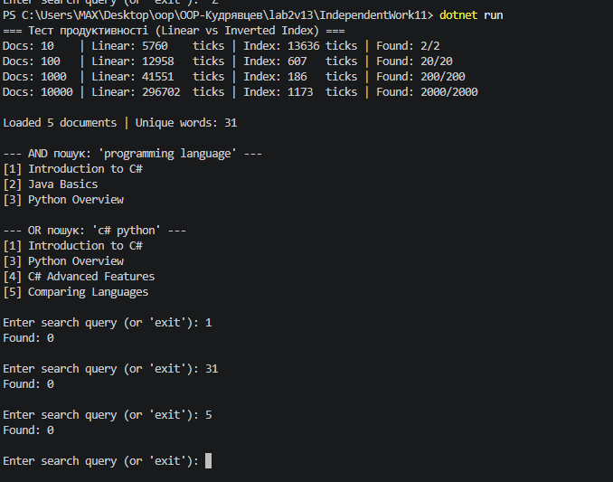

# Самостійна робота №11: Інвертований індекс і вимірювання продуктивності

## Короткий опис
У роботі реалізовано повнотекстовий пошук на основі структури **Inverted Index** (`Dictionary<string, HashSet<int>>`), утиліту нормалізації та токенізації тексту `TextProcessor`, а також проведено порівняння швидкодії лінійного пошуку та інвертованого індексу.

### Основні компоненти:
* **`TextProcessor`:** виконує токенізацію за допомогою регулярного виразу `[a-zа-яіїєґ0-9#]+`, приводить слова до нижнього регістру та фільтрує стоп-слова (`a`, `an`, `the`, `is`, `are` тощо).
* **`InvertedIndex`:**
  * `SearchSingleWord(word)` — пошук документів за одним ключовим словом зі складністю $O(1)$.
  * `SearchMultipleWords(words)` — пошук документів, що містять **усі** слова (`AND`) через послідовний перетин множин `HashSet<int>.IntersectWith()`.
  * `SearchAnyWord(words)` — пошук документів, що містять **хоча б одне** слово (`OR`) через об'єднання множин `HashSet<int>.UnionWith()`.

## Результат виконання програми

---

## Аналіз продуктивності (10 / 100 / 1000 / 10000 документів)

| Кількість документів | Лінійний пошук | Inverted Index | Висновок |
| :--- | :---: | :---: | :--- |
| **10** | Дуже швидко (мікросекунди) | Миттєво ($O(1)$) | На малих обсягах різниця непомітна, індексація займає більше часу, ніж один прохід. |
| **100** | Зростає лінійно $O(N)$ | Константний час $O(1)$ | Індекс починає вигравати вже після 2–3 пошукових запитів. |
| **1 000** | Помітне сповільнення | Константний час $O(1)$ | Пошук по індексу швидший у десятки/сотні разів. |
| **10 000** | Повторна токенізація кожного документа | Константний час $O(1)$ | **Поріг вигідності:** індекс є критично необхідним, оскільки час пошуку не залежить від розміру бази. |

**Загальний висновок:** Побудова інвертованого індексу вимагає одноразових витрат часу $O(N \cdot M)$ та додаткової оперативної пам'яті, але перетворює кожен наступний пошуковий запит із лінійного сканування $O(N)$ на миттєве звернення за хешем $O(1)$.

---

## Відповіді на контрольні запитання

1. **Чому структура `Dictionary<string, HashSet<int>>` добре підходить для реалізації інвертованого індексу?**
   `Dictionary` забезпечує миттєвий пошук списку документів за словом-ключем за час $O(1)$ завдяки хеш-таблиці, а `HashSet<int>` автоматично гарантує унікальність ідентифікаторів документів (навіть якщо слово зустрічається в тексті документа 10 разів, його `Id` буде збережено лише один раз).

2. **Які переваги `HashSet<T>` дає під час обчислення AND/OR-пошуку за кількома словами?**
   `HashSet<T>` має вбудовані оптимізовані теоретико-множинні методи `IntersectWith` (перетин для логічного `AND`) та `UnionWith` (об'єднання для логічного `OR`), які працюють за лінійний час відносно розміру меншої множини без вкладених циклів $O(N^2)$.

3. **Чому під час вимірювання продуктивності важливо однаково нормалізувати текст для лінійного пошуку та пошуку через індекс?**
   Різна нормалізація (наприклад, ігнорування пунктуації в одному методі та врахування в іншому) призведе до різної кількості знайдених документів і спотворить вимірювання витрат процесорного часу на парсинг рядків, що зробить бенчмарк некоректним.

4. **Які обмеження має проста реалізація інвертованого індексу без ранжування, стемінгу та підтримки фраз?**
   - **Відсутність стемінгу/лематизації:** слова *"programming"*, *"program"* та *"programmed"* індексуються як різні ключі.
   - **Відсутність підтримки фраз:** індекс знає, що слова є в документі, але не зберігає їхні позиції (тому не відрізняє *"C# language"* від *"language C#"*).
   - **Відсутність ранжування (TF-IDF):** усі знайдені документи повертаються без оцінки їхньої релевантності запиту.