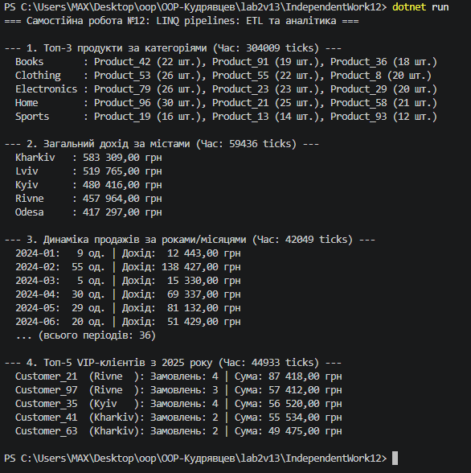

# Самостійна робота №12: LINQ pipelines: ETL та аналітика

## Короткий опис
У роботі реалізовано 4 аналітичні LINQ-пайплайни для обробки згенерованих даних моделі «Продажі» (`Product`, `Customer`, `Sale` по 100+ елементів):
1. **Топ-3 продукти за категоріями:** послідовне групування продажів (`GroupBy`), з'єднання з довідником товарів (`Join`), повторне групування за категорією та відбір лідерів (`OrderByDescending` + `Take(3)`).
2. **Загальний дохід за містами:** подвійний `Join` продажів із продуктами та клієнтами, агрегація виручки (`Sum`) за містами та сортування за спаданням.
3. **Продажі за місяцями та роками:** групування за складеним ключем `new { Year, Month }`, підрахунок кількості одиниць та доходу з хронологічним сортуванням (`OrderBy` + `ThenBy`).
4. **Топ-5 VIP-клієнтів (власний пайплайн):** фільтрація продажів з 2025 року (`Where`), об'єднання (`Join`), групування за клієнтом (`GroupBy`) та визначення 5 клієнтів з найбільшою сумою покупок.

## Результат виконання програми

---

## Аналіз продуктивності
- Перший пайплайн (`TopProductsByCategory`) зазвичай виконується найдовше, оскільки містить **два послідовних `GroupBy`**, `Join` та внутрішні сортування для кожної категорії. Також на перший запит впливає холодний старт JIT-компіляції.
- Пайплайни з одним `Join` та `GroupBy` працюють значно швидше ($O(N + M)$ завдяки внутрішнім хеш-таблицям LINQ).
- **Висновок:** LINQ чудово підходить для ETL та аналітики в пам'яті завдяки декларативності, відкладеному виконанню (Deferred Execution) та відсутності громіздких вкладених циклів.

---

## Відповіді на контрольні запитання

1. **Переваги LINQ для ETL-пайплайнів порівняно з ручними циклами:**
   Декларативний стиль (код описує *що* потрібно отримати, а не *як* ітерувати), композиційність кроків (Extract $\rightarrow$ Transform $\rightarrow$ Load), відсутність проміжних тимчасових колекцій завдяки відкладеному виконанню (`IEnumerable<T>`) та менша ймовірність помилок в індексах.

2. **Чому для аналітичних задач поєднують `Join`, `GroupBy`, `Select` та `OrderBy`:**
   `Join` збагачує факти даними з довідників (деномалізація), `GroupBy` розбиває дані на аналітичні зрізи (за категоріями, містами чи датами), `Select` обчислює агреговані метрики (`Sum`, `Count`, `Average`), а `OrderBy` ранжує фінальний звіт.

3. **Фактори впливу на продуктивність складних LINQ-запитів:**
   Кількість матеріалізацій (зайві виклики `.ToList()` всередині пайплайну), складність сортування ($O(N \log N)$), багаторазова ітерація по відкладеному запиту, а також розмір колекцій і накладні витрати на створення анонімних об'єктів.

4. **Як перевірити, що LINQ-пайплайн залишається читабельним і підтримуваним:**
   Розбивати складні пайплайни на окремі іменовані методи з чіткою відповідальністю, уникати глибокої вкладеності лямбда-виразів (понад 2–3 рівні) та використовувати іменовані `record`/DTO-типи замість складних анонімних об'єктів при передачі даних між методами.