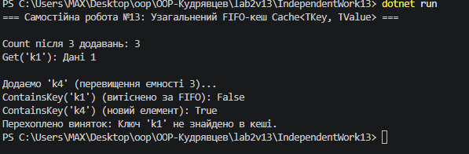

# Самостійна робота №13: Узагальнений кеш Cache<TKey, TValue> із тестами

## Короткий опис
Реалізовано узагальнений клас кешу `Cache<TKey, TValue>` із фіксованою ємністю та політикою витіснення **FIFO** (First In, First Out), а також проєкт юніт-тестів `IndependentWork13.Tests` на базі **xUnit**.

### Основні елементи рішення:
* **`Dictionary<TKey, TValue>`** — зберігає пари ключ-значення та забезпечує доступ за час $O(1)$.
* **`Queue<TKey>`** — фіксує порядок додавання ключів для видалення найстарішого елемента при переповненні (`Dequeue()`).
* **`IndependentWork13.Tests`** — 6 юніт-тестів, що перевіряють `Add`, `Get`, `ContainsKey`, `Count`, оновлення існуючого ключа, FIFO-витіснення та виняток `KeyNotFoundException`.

## Результати виконання тестів (`dotnet test`)

---

## Відповіді на контрольні запитання

1. **Які переваги надає `Cache<TKey, TValue>` порівняно з окремими неузагальненими реалізаціями кешу?**
   - **Типобезпечність на етапі компіляції:** виключає помилки `InvalidCastException` під час виконання.
   - **Висока продуктивність:** відсутні витрати на упаковку/розпаковку (`boxing`/`unboxing`) для значущих типів (`int`, `double`, `struct`).
   - **Повторне використання коду:** один клас працює з будь-якими типами ключів і значень без дублювання коду.

2. **Чому для реалізації політики FIFO зручно поєднувати `Dictionary<TKey, TValue>` з `Queue<TKey>` або `LinkedList<TKey>`?**
   `Dictionary` забезпечує миттєве отримання та перевірку наявності ключа за $O(1)$, але не гарантує хронологічного порядку елементів. Додаткова черга `Queue<TKey>` зберігає порядок вставки і дозволяє за $O(1)$ дістати найстаріший ключ (`Dequeue()`) для видалення зі словника (або `LinkedList<TKey>` — якщо потрібне розширення до LRU з переміщенням елементів у середині списку).

3. **У яких випадках метод `Get` повинен викидати `KeyNotFoundException`, а коли доцільніше використовувати `TryGetValue`?**
   `Get` із `KeyNotFoundException` використовується, коли відсутність ключа є порушенням контракту виклику (програма очікує, що ключ точно існує). Підхід `TryGetValue(key, out value)` краще застосовувати в штатних сценаріях промаху кешу (cache miss), щоб уникнути накладних витрат на генерацію винятків.

4. **Які тести є критично важливими для перевірки політики витіснення елементів з кешу?**
   - Тест на додавання елементів понад задану ємність (`capacity`).
   - Тест на перевірку того, що видаляється саме **перший доданий** елемент (`First In`), а новіші залишаються доступними.
   - Тест на оновлення значення за вже існуючим ключем (перевірка, що `Count` не зростає і зайве витіснення не відбувається).