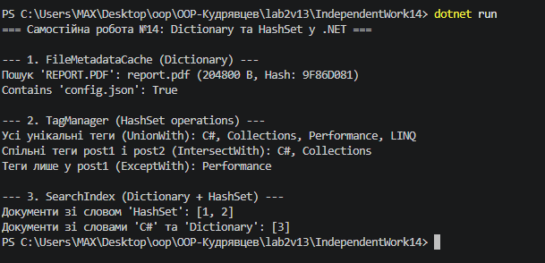

# Самостійна робота №14: Вивчення Dictionary<TKey, TValue> та HashSet<T> у бібліотеках .NET

## Опис проєкту
Консольний застосунок демонструє практичне застосування узагальнених хеш-колекцій .NET:
1. **`FileMetadataCache`** (`Dictionary<string, FileMetadata>` із `StringComparer.OrdinalIgnoreCase`) — кешування метаданих файлів за іменем без урахування регістру.
2. **`TagManager`** (`Dictionary<string, HashSet<string>>`) — управління унікальними тегами статей із застосуванням операцій `UnionWith`, `IntersectWith` та `ExceptWith`.
3. **`SearchIndex`** (`Dictionary<string, HashSet<int>>`) — інвертований індекс для пошуку документів за одним або кількома ключовими словами.

Детальний аналіз open-source репозиторіїв (`Dapper`, `Newtonsoft.Json`, `.NET Runtime`) та порівняльна таблиця складності знаходяться у файлі [REPORT.md](REPORT.md).

## Результат виконання програми

---

## Відповіді на контрольні запитання

1. **Які переваги generic-колекцій над неузагальненими структурами даних у .NET?**
   - **Безпека типів (Type Safety):** контроль типів під час компіляції унеможливлює помилки `InvalidCastException` у runtime.
   - **Продуктивність:** відсутні накладні витрати на упаковку та розпаковку (`boxing`/`unboxing`) при роботі зі значущими типами (`int`, `DateTime`, `struct`).

2. **У яких сценаріях доцільніше використовувати `Dictionary<TKey, TValue>`, а в яких — `HashSet<T>`?**
   - `Dictionary` використовують, коли потрібно зіставити унікальному ключу певне значення або об'єкт (кеш, довідник, індекс).
   - `HashSet` використовують, коли важливий сам факт унікальної присутності елемента у множині та швидкі теоретико-множинні операції (фільтрація дублікатів, спільні теги).

3. **Як `IEqualityComparer<T>` впливає на коректність і продуктивність `Dictionary` та `HashSet`?**
   `IEqualityComparer<T>` визначає правила обчислення хеш-коду (`GetHashCode`) та еквівалентності (`Equals`). Коректність залежить від дотримання контракту: рівні об'єкти **обов'язково** повинні повертати однаковий хеш-код. Продуктивність залежить від рівномірності хеш-функції — що менше колізій, то ближче складність операцій до ідеального $O(1)$.

4. **Чому інвертований індекс зручно будувати саме на базі `Dictionary<string, HashSet<int>>`?**
   `Dictionary` забезпечує миттєвий перехід від пошукового слова до списку документів за $O(1)$, а `HashSet<int>` автоматично виключає дублювання ID одного й того ж документа та дозволяє за допомогою `IntersectWith` швидко знаходити перетин результатів для багатокритеріального пошуку.