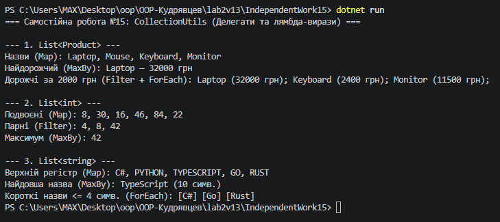

# Самостійна робота №15: Делегати й лямбда-вирази: власні утиліти для колекцій

## Короткий опис
У роботі реалізовано статичний узагальнений клас `CollectionUtils` із чотирма методами для обробки колекцій (`Map`, `MaxBy`, `Filter`, `ForEach`) з використанням стандартних делегатів `Func`, `Predicate` та `Action` і відкладеного виконання (`yield return`). Роботу продемонстровано на трьох типах колекцій: `List<Product>`, `List<int>` та `List<string>`.

## Результат виконання програми

---

## Звіт

### 1. Чому делегати корисні для створення таких утиліт?
Делегати дозволяють передавати логіку обробки (поведінку) як аргумент методу. Завдяки цьому алгоритм обходу колекції відокремлюється від конкретної дії над її елементами, що забезпечує повторне використання коду без дублювання циклів `foreach` для кожного нового сценарію.

### 2. Як лямбда-вирази спрощують виклик цих методів?
Лямбда-вирази (`p => p.Price > 2000m`) дозволяють описувати короткі анонімні функції безпосередньо в місці виклику методу без необхідності оголошувати окремі іменовані методи чи громіздкі анонімні делегати. Це робить код декларативним і легким для читання.

### 3. Порівняння власних методів із вбудованими LINQ-операторами

| Власний метод (`CollectionUtils`) | Делегат | Аналог у LINQ / .NET | Особливості |
| :--- | :--- | :--- | :--- |
| `Map<TSource, TResult>` | `Func<TSource, TResult>` | `Enumerable.Select()` | Проектує кожен елемент у новий тип/форму; працює ліниво через `yield return`. |
| `MaxBy<T, TKey>` | `Func<T, TKey>` | `Enumerable.MaxBy()` (.NET 6+) | Знаходить елемент за максимальним ключем `IComparable<TKey>` за один прохід $O(N)$. |
| `Filter<T>` | `Predicate<T>` | `Enumerable.Where()` | Фільтрує елементи за булевою умовою (`Predicate<T>` замість `Func<T, bool>`). |
| `ForEach<T>` | `Action<T>` | `List<T>.ForEach()` | Працює для будь-якого `IEnumerable<T>`, а не лише для `List<T>`. |

---

## Відповіді на контрольні запитання

1. **Чому делегати є зручним механізмом для передавання поведінки в узагальнені методи?**
   Вони забезпечують типобезпечне посилання на метод із заданою сигнатурою, дозволяючи параметризувати алгоритми не лише типами даних (через generics), а й логікою їх обробки.

2. **У чому різниця між `Func<T, TResult>`, `Action<T>` та `Predicate<T>`?**
   - `Func<T, TResult>` — приймає аргумент типу `T` і повертає результат типу `TResult`.
   - `Action<T>` — приймає аргумент типу `T` і виконує дію без повернення значення (`void`).
   - `Predicate<T>` — приймає аргумент типу `T` і завжди повертає `bool` (використовується для перевірки умов).

3. **Які переваги дає поєднання generic-методів і лямбда-виразів під час роботи з колекціями?**
   Компілятор автоматично виводить типи параметрів лямбда-виразу (Type Inference) на основі колекції, що гарантує сувору перевірку типів на етапі компіляції, високу швидкодію без `boxing/unboxing` і лаконічний синтаксис.

4. **У яких випадках власні утиліти на кшталт `Map` чи `Filter` корисно реалізувати самостійно, навіть якщо існує LINQ?**
   Для оптимізації критичних до пам'яті ділянок коду (наприклад, у геймдеві або high-load системах, щоб уникнути зайвих алокацій ітераторів LINQ), при роботі зі специфічними структурами даних або в середовищах із обмеженою стандартною бібліотекою.