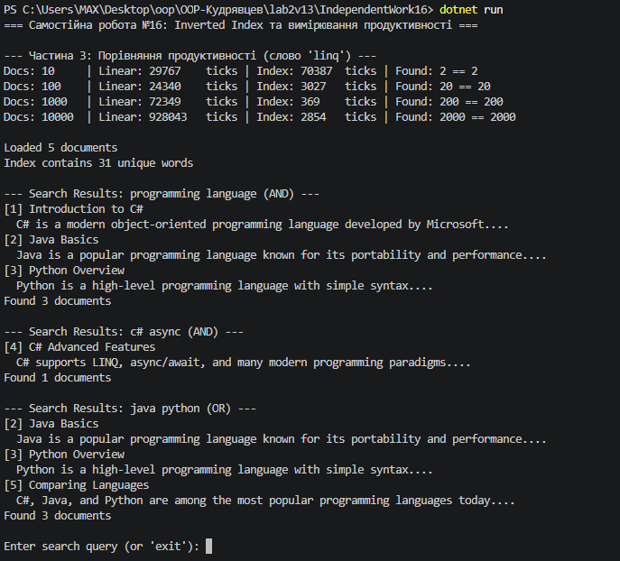

# Самостійна робота №16: Колекції в практиці ООП: інвертований індекс і вимірювання продуктивності

## Короткий опис
Консольний застосунок демонструє роботу структури даних **Inverted Index** (`Dictionary<string, HashSet<int>>`) для швидкого пошуку за одним словом, комбінацією всіх слів (`AND` через `IntersectWith`) та будь-якого зі слів (`OR` через `UnionWith`), а також порівнює його швидкодію з лінійним пошуком на обсягах 10, 100, 1000 та 10000 документів.

Детальний аналіз і таблиця вимірювань наведені у файлі [REPORT.md](REPORT.md).

## Результат виконання програми

---

## Відповіді на контрольні запитання

1. **Чому структура `Dictionary<string, HashSet<int>>` добре підходить для реалізації інвертованого індексу?**
   `Dictionary` забезпечує миттєвий доступ до списку документів за ключем-словом зі складністю $O(1)$ завдяки хеш-таблиці, а `HashSet<int>` автоматично виключає дублювання ідентифікаторів документів, якщо слово зустрічається в тексті одного документа кілька разів.

2. **Які переваги `HashSet<T>` дає під час обчислення AND/OR-пошуку за кількома словами?**
   `HashSet<T>` надає оптимізовані методи `IntersectWith` (перетин множин для `AND`) та `UnionWith` (об'єднання множин для `OR`), які виконуються за лінійний час відносно розміру множини без необхідності писати вкладені цикли $O(N^2)$.

3. **Чому під час вимірювання продуктивності важливо однаково нормалізувати текст для лінійного пошуку та пошуку через індекс?**
   Різна нормалізація призведе до різної кількості знайдених документів (некоректний тест) та спотворить вимірювання витрат процесорного часу на роботу регулярних виразів і створення рядків.

4. **Які обмеження має проста реалізація інвертованого індексу без ранжування, стемінгу та підтримки фраз?**
   - **Відсутність стемінгу:** однокореневі слова (*"program"*, *"programming"*) зберігаються як різні ключі.
   - **Відсутність підтримки фраз:** індекс не зберігає позиції слів у тексті, тому не відрізняє точну фразу від слів у різних частинах документа.
   - **Відсутність ранжування (TF-IDF):** результати не сортуються за релевантністю.