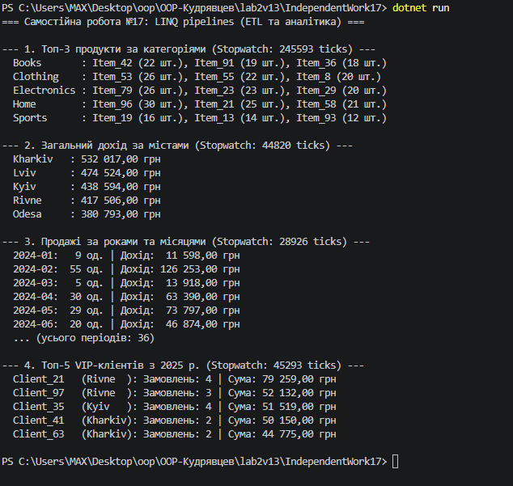

# Самостійна робота №17: LINQ pipelines: ETL та аналітика

## Опис реалізованих пайплайнів
Для моделювання процесів ETL (Extract $\rightarrow$ Transform $\rightarrow$ Load) згенеровано 100 товарів, 100 клієнтів та 200 продажів із фіксованим генератором `Random(42)`.

1. **`TopProductsByCategory` (Найпопулярніші продукти за категоріями):**
   * *Оператори:* `GroupBy` (по товару) $\rightarrow$ `Select` + `Sum` $\rightarrow$ `Join` (із довідником товарів) $\rightarrow$ `GroupBy` (по категорії) $\rightarrow$ `OrderByDescending` + `Take(3)`.
   * *Призначення:* визначає трійку лідерів продажів за кількістю одиниць у кожній категорії.
2. **`TotalRevenueByCity` (Загальний дохід за містами клієнтів):**
   * *Оператори:* подвійний `Join` (продажі + товари + клієнти) $\rightarrow$ `GroupBy` (за містом) $\rightarrow$ `Select` + `Sum` $\rightarrow$ `OrderByDescending`.
   * *Призначення:* обчислює виручку для кожної транзакції та формує рейтинг міст за сумарним доходом.
3. **`SalesByYearAndMonth` (Продажі за місяцями та роками):**
   * *Оператори:* `Join` $\rightarrow$ `GroupBy` (за складеним ключем `new { Year, Month }`) $\rightarrow$ `Select` (`Sum` кількості та виручки) $\rightarrow$ `OrderBy` + `ThenBy`.
   * *Призначення:* будує хронологічний звіт динаміки продажів.
4. **`TopVipCustomers` (Додатковий пайплайн — Топ-5 VIP-клієнтів з 2025 р.):**
   * *Оператори:* `Where` $\rightarrow$ `Join` $\rightarrow$ `GroupBy` $\rightarrow$ `Select` $\rightarrow$ `Join` $\rightarrow$ `OrderByDescending` $\rightarrow$ `Take(5)`.
   * *Призначення:* фільтрує актуальні продажі та визначає 5 найцінніших клієнтів.

## Результат виконання програми

---

## Аналіз продуктивності та висновки
* **Аналіз замірів (`Stopwatch`):** Найбільше тиків витрачається на перший пайплайн (`TopProductsByCategory`), оскільки під час його першого виклику відбувається **JIT-компіляція** LINQ-методів та делегатів, а також виконуються два каскадні групування `GroupBy` і внутрішні сортування. Наступні пайплайни виконуються значно швидше ($O(N + M)$ завдяки внутрішнім хеш-таблицям оператора `Join`).
* **Висновок:** LINQ є високоефективним інструментом для аналітики в пам'яті — декларативний стиль робить ETL-перетворення компактними, прозорими та захищеними від помилок індексації, а відкладене виконання (Deferred Execution) дозволяє будувати ланцюжки без проміжних масивів.

---

## Відповіді на контрольні запитання

1. **Які переваги дає LINQ для побудови ETL-пайплайнів порівняно з ручними циклами?**
   Декларативність (опис бізнес-логіки замість механіки ітерацій), відкладене виконання (`IEnumerable<T>` без створення зайвих проміжних списків), висока читабельність та легка композиція етапів очищення, збагачення й агрегації даних.

2. **Чому для аналітичних задач часто поєднують `Join`, `GroupBy`, `Select` та `OrderBy` в одному пайплайні?**
   `Join` об'єднує таблицю фактів із довідниками (деномалізація), `GroupBy` розбиває дані на аналітичні сегменти, `Select` розраховує агреговані показники (`Sum`, `Count`, `Average`), а `OrderBy` впорядковує фінальний звіт.

3. **Які фактори можуть найбільше впливати на продуктивність складних LINQ-запитів?**
   Передчасна матеріалізація (зайві виклики `.ToList()` всередині пайплайну), повторна ітерація по відкладеному запиту, складність сортування $O(N \log N)$, алокація анонімних об'єктів у великих циклах і холодний старт JIT.

4. **Як перевірити, що LINQ-пайплайн не лише працює, а й залишається читабельним і підтримуваним?**
   Кожен аналітичний запит варто виносити в окремий метод із говорящою назвою, уникати понад 2 рівнів вкладеності лямбда-виразів та використовувати іменовані `record`-типи замість складних анонімних структур.