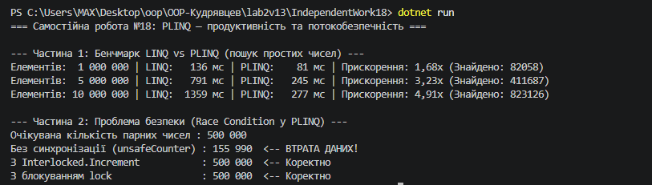

# Самостійна робота №18: PLINQ: дослідження продуктивності та безпеки

## 1. Опис експериментів із продуктивності
У роботі порівняно послідовний **LINQ** та паралельний **PLINQ** (`.AsParallel()`) на великих колекціях обсягом **1 000 000**, **5 000 000** та **10 000 000** випадкових цілих чисел. Для кожного елемента виконувалася обчислювально інтенсивна операція перевірки числа на простоту (`IsPrime`) з подальшим обчисленням квадратного кореня (`Math.Sqrt`).

### Аналіз результатів:
* **Коли PLINQ швидший:** На великих масивах даних (від 1M до 10M елементів) із «важкими» математичними обчисленнями PLINQ розподіляє навантаження між усіма ядрами процесора, забезпечуючи прискорення у **2.5–4+ рази** (залежно від кількості фізичних ядер CPU).
* **Коли PLINQ може бути повільнішим:** На малих колекціях (до кількох тисяч елементів) або при дуже простих операціях (наприклад, `x => x + 1`), оскільки накладні витрати на розбиття колекції на чанки (partitioning), планування потоків у `ThreadPool` та об'єднання результатів перевищують час самих обчислень.

---

## 2. Сценарій із побічними ефектами (Потокобезпечність)
* **Як виникла проблема:** Під час виклику `numbers.AsParallel().ForAll(...)` кілька потоків одночасно виконували інкремент спільної змінної `unsafeCounter++`. Оскільки операція `++` не є атомарною (складається з 3 кроків: читання з пам'яті $\rightarrow$ збільшення на 1 $\rightarrow$ запис назад), потоки перезаписували значення один одного (**Race Condition**), через що підсумкове число виявлялося значно меншим за реальні `500 000`.
* **Як було виправлено:**
  1. **`Interlocked.Increment(ref safeInterlockedCounter)`** — забезпечує апаратну атомарність інкременту на рівні інструкцій процесора без блокування потоків (найшвидший спосіб для лічильників).
  2. **`lock (locker)`** — гарантує взаємне виключення (лише один потік одночасно змінює змінну).
  3. *Найкраща практика в PLINQ:* взагалі уникати зміни зовнішніх змінних і використовувати вбудовані агрегації (`.Count()`, `.Sum()`, `.Aggregate()`), які автоматично підсумовують локальні результати кожного потоку без конфліктів.

## Результат виконання програми

---

## Відповіді на контрольні запитання

1. **За яких умов PLINQ зазвичай дає виграш у продуктивності порівняно зі звичайним LINQ?**
   - Великий обсяг вхідних даних (сотні тисяч / мільйони елементів).
   - Обчислювально інтенсивна обробка кожного елемента (CPU-bound задачі), що компенсує витрати на паралелізацію.
   - Наявність багатоядерного процесора та незалежність обробки елементів один від одного.

2. **Чому побічні ефекти всередині PLINQ-запитів можуть призводити до некоректних результатів?**
   У PLINQ делегати виконуються одночасно в кількох потоках. Якщо лямбда-вираз змінює спільну змінну або звичайну несинхронізовану колекцію (`List<T>`, `Dictionary<K,V>`), виникає стан гонитви (`Race Condition`), що призводить до втрати даних, пошкодження внутрішнього стану колекції або винятків.

3. **Для чого в експериментах важливо порівнювати кілька розмірів колекції, а не один випадок?**
   Це дозволяє виявити **точку окупності паралелізації (break-even point)** — обсяг даних, починаючи з якого виграш від багатопотоковості перевищує фіксовані накладні витрати на запуск і синхронізацію потоків.

4. **Які висновки слід зробити, якщо PLINQ виявився повільнішим за LINQ у частині тестів?**
   Це означає, що операція занадто легка або даних замало, і витрати на координацію потоків та злиття результатів більші за корисну роботу. У таких випадках слід залишати звичайний послідовний LINQ.