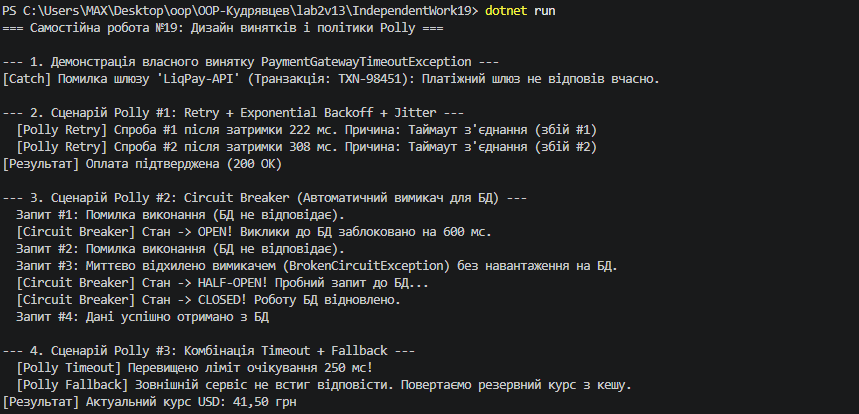

# Самостійна робота №19: Дизайн винятків і політики retry: теорія та кейси Polly

## 1. Опис сценаріїв та обґрунтування стратегій Polly

### Власний виняток: `PaymentGatewayTimeoutException`
Успадкований від `System.Exception`, містить три обов'язкові конструктори та додаткові властивості `TransactionId` і `GatewayName` для діагностики помилок платіжних операцій.

### Сценарій 1: `Retry` + `Exponential Backoff` + `Jitter` (Виклик платіжного API)
* **Проблема:** Короткочасні мережеві збої або тимчасова перевантаженість платіжного шлюзу (перші 2 запити завершуються таймаутом, 3-й проходить).
* **Обґрунтування стратегії:** Застосовано `AddRetry` з експоненційною затримкою (`DelayBackoffType.Exponential`) та випадковим відхиленням (`UseJitter = true`), щоб дати серверу час відновитися й уникнути одночасного «шторму» запитів від багатьох клієнтів.
* **Опис виводу:** Консоль логує невдалі спроби #1 та #2 із часом очікування перед повтором, після чого 3-тя спроба повертає `Оплата підтверджена (200 OK)`.

### Сценарій 2: `Circuit Breaker` (Захист від тривалого збою бази даних)
* **Проблема:** База даних повністю недоступна. Повторні спроби (`Retry`) лише даремно блокують потоки застосунку.
* **Обґрунтування стратегії:** Використано `AddCircuitBreaker` (`MinimumThroughput = 2`, `BreakDuration = 600 мс`). Після двох невдач вимикач переходить у стан **Open** і миттєво відхиляє наступні виклики без звернення до БД. Через 600 мс переходить у **Half-Open**, пропускає пробний запит і після успіху повертається у **Closed**.
* **Опис виводу:** Запити #1 і #2 фіксують помилку БД, вимикач відкривається, запит #3 миттєво відхиляється через `BrokenCircuitException`, а запит #4 після паузи відновлює з'єднання.

### Сценарій 3: Комбінація `Timeout` + `Fallback` (Отримання курсу валют)
* **Проблема:** Зовнішній сервіс курсів валют «зависає» на 1 секунду, що погіршує швидкість відповіді нашого застосунку.
* **Обґрунтування стратегії:** Внутрішній `AddTimeout` (250 мс) примусово скасовує повільний запит через `CancellationToken` і генерує `TimeoutRejectedException`, а зовнішній `AddFallback` перехоплює цей виняток і повертає резервне значення з кешу (`41.50 грн`).

---

## 2. Коли кидати виняток, а коли повертати `Result<T>`
* **Винятки (`Exception`)** слід використовувати для справді виняткових, непередбачуваних ситуацій, коли метод не може виконати свій контракт: розрив з'єднання з БД, відсутність критичного файлу, мережевий таймаут або некоректний формат системних даних.
* **Патерн `Result<T>`** доцільно застосовувати для очікуваних, штатних сценаріїв невдачі у бізнес-логіці: помилки валідації вводу користувача, невірний пароль, відсутність товару на складі чи пошук запису, якого може не існувати. `Result<T>` робить можливу невдачу явною в сигнатурі методу та працює значно швидше, ніж розкручування стека винятків.

---

## 3. Висновки щодо переваг і обмежень Polly
* **Переваги:** Декларативна конфігурація складних політик відмовостійкості через `ResiliencePipelineBuilder`, можливість комбінувати стратегії (наприклад, `Fallback` + `Retry` + `CircuitBreaker` + `Timeout`), вбудована підтримка `Jitter` і `CancellationToken`, відсутність самописного шаблонного коду з циклами `while` і `Thread.Sleep`.
* **Обмеження:** Неправильне налаштування порогів (наприклад, занадто агресивний `Retry` без `Circuit Breaker`) може посилити навантаження на вже «впалий» сервіс (каскадний збій), а також не можна застосовувати `Retry` до неідемпотентних операцій без захисту від дублювання.

## Результат виконання програми

---

## Відповіді на контрольні запитання

1. **Різниця між підходами «кидати виняток» та «повертати Result»:**
   Виняток перериває нормальний потік виконання і розкручує стек викликів (приклад: `SqlException` при втраті зв'язку з сервером БД). `Result<T>` повертає звичайний об'єкт зі статусом `IsSuccess` та описом помилки без генерації винятку (приклад: `Result<User>.Failure("Користувача з таким email не знайдено")`).

2. **Три стандартні конструктори власного типу винятку:**
   - `public MyException()` — конструктор без параметрів;
   - `public MyException(string message) : base(message)` — конструктор із текстовим описом;
   - `public MyException(string message, Exception innerException) : base(message, innerException)` — конструктор для збереження першопричини помилки (`InnerException`).

3. **Чим `Circuit Breaker` відрізняється від `Retry` і коли який патерн доцільніший?**
   `Retry` повторює запит у надії, що тимчасовий збій уже минув (доцільний при короткочасних мережевих «миготіннях»). `Circuit Breaker` повністю блокує виклики на певний час після серії помилок, даючи системі відновитися (доцільний, коли зовнішній сервіс або БД вийшли з ладу надовго).

4. **Для чого потрібен `Bulkhead` і яку проблему він вирішує?**
   `Bulkhead` («перегородка») обмежує кількість одночасних викликів або виділених потоків для певного сервісу. Це запобігає вичерпанню пулу потоків (`ThreadPool starvation`) усього застосунку, якщо один із зовнішніх сервісів почне відповідати занадто повільно.

5. **Чому `Jitter` важливий при реалізації `Retry` з експоненційною затримкою?**
   Без `Jitter` тисячі клієнтів, які одночасно отримали помилку, робитимуть повторні спроби в однакові моменти часу (`1с`, `2с`, `4с`), створюючи синхронізовані піки навантаження (ефект *Thundering Herd*). Випадкова затримка (`Jitter`) рівномірно розподіляє повторні запити в часі.

6. **Які ризики виникають при застосуванні `Retry` до неідемпотентної операції?**
   Неідемпотентна операція (наприклад, списання коштів з картки або створення нового замовлення без ключа ідемпотентності) при повторному виконанні після таймауту відповіді може виконатися **двічі**, що призведе до подвійного списання грошей або дублювання записів у БД.