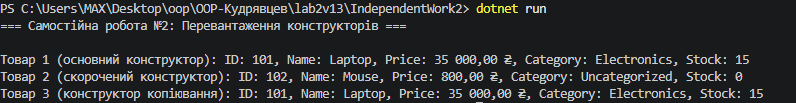

# Самостійна робота №2: Перевантаження конструкторів: приклади та сценарії

## Короткий опис
У даній роботі реалізовано клас `Product` із 5 read-only властивостями та 3 перевантаженими конструкторами:
* **Основний конструктор:** приймає всі 5 параметрів (`id`, `name`, `price`, `category`, `stockCount`).
* **Скорочений конструктор:** приймає 3 параметри (`id`, `name`, `price`) та перенаправляє виклик до основного через `: this(id, name, price, "Uncategorized", 0)`.
* **Конструктор копіювання:** приймає інший об'єкт `Product` та викликає основний конструктор через `: this(other.Id, other.Name, other.Price, other.Category, other.StockCount)`.

Також перевизначено метод `ToString()` для форматованого виводу інформації про товар.

## Результат виконання програми

## Відповіді на контрольні запитання
1. **Потреба у перевантаженні конструкторів у класі `Product`:**
   Забезпечує гнучкість при створенні об'єктів у ситуаціях з різним рівнем деталізації даних (наприклад, коли відомі лише базові дані товару або коли потрібно створити точний дублікат).

2. **Зручність реалізації конструктора копіювання через `this(...)`:**
   Це запобігає дублюванню коду ініціалізації полів (принцип DRY) та гарантує, що вся логіка створення об'єкта зосереджена в одному основному конструкторі.

3. **Переваги read-only доступу до властивостей:**
   Забезпечує **незмінність (immutability)** станiв об'єкта після його створення, що робить код більш безпечним від випадкових або некоректних зовнішніх модифікацій.

4. **Перевизначення `ToString()` для налагодження та демонстрації:**
   Дозволяє отримувати зрозуміле та зручно відформатоване текстове представлення об'єкта при виклику `Console.WriteLine(product)` або в панелі відлагодження середовища розробки без написання додаткових методів друку.

## Висновок
Під час виконання самостійної роботи закріплено навички перевантаження конструкторів, використання синтаксису `: this(...)`, створення read-only властивостей та перевизначення `ToString()`.