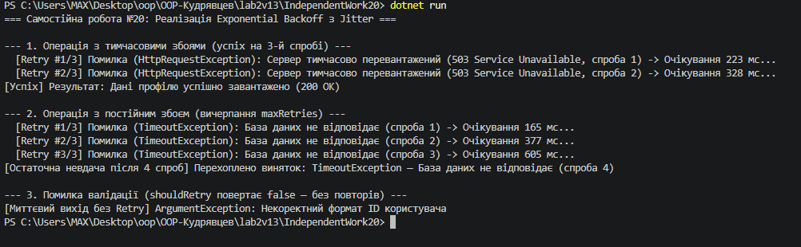

# Самостійна робота №20: Реалізація exponential backoff

## Короткий опис
У проєкті реалізовано власний узагальнений клас **`RetryPolicy`** із підтримкою експоненційної затримки (**Exponential Backoff**), випадкового відхилення (**Jitter** за формулою `initialDelay * 2^attempt * (1 + rand * jitter * 2 - jitter)`) та фільтрації винятків через делегат `shouldRetry`.

Продемонстровано 3 сценарії:
1. Успішне завершення мережевого запиту на 3-й спробі після двох тимчасових помилок `HttpRequestException`.
2. Вичерпання ліміту `maxRetries` при постійному збої бази даних (`TimeoutException`) із прокиданням винятку назовні.
3. Миттєве припинення без повторних спроб для нетимчасової помилки (`ArgumentException`), де `shouldRetry` повертає `false`.

## Результат виконання програми

---

## Висновок щодо меж застосування патерну Retry з Exponential Backoff
Патерн **Retry з Exponential Backoff та Jitter** є високоефективним для подолання короткочасних, самовідновлюваних збоїв: мережевих затримок, тимчасової перевантаженості API (`HTTP 429` / `503`) або коротких блокувань рядків у базі даних. Водночас він має чіткі межі застосування:
* **Не виправляє логічні помилки:** повторювати запити при помилках валідації (`ArgumentException`), автентифікації (`HTTP 401/403`) або відсутності ресурсу (`HTTP 404`) безглуздо — тому критично важливо обмежувати типи винятків через `shouldRetry`.
* **Не підходить для тривалих збоїв:** якщо зовнішній сервіс «впав» надовго, агресивні повтори лише вичерпують потоки застосунку (у таких випадках `Retry` потрібно поєднувати з патерном **Circuit Breaker**).
* **Вимагає ідемпотентності:** повторні спроби безпечні лише тоді, коли повторне виконання операції не призводить до дублювання побічних ефектів (наприклад, подвійного списання коштів).

---

## Відповіді на контрольні запитання

1. **Чому експоненційна затримка зазвичай ефективніша за фіксовану для тимчасових збоїв?**
   При перевантаженні сервера фіксовані короткі інтервали (наприклад, кожні 100 мс) продовжують «добивати» його запитами. Експоненційне зростання інтервалів (`200 мс` $\rightarrow$ `400 мс` $\rightarrow$ `800 мс`...) надає віддаленому сервісу достатньо часу на розвантаження черги та відновлення працездатності.

2. **Для чого потрібен jitter і як він зменшує ризик одночасних повторних спроб?**
   Якщо тисячі клієнтів одночасно отримали збій, без `jitter` усі вони обчислять однакову експоненційну затримку й надішлють повторні запити в ту саму мілісекунду (ефект *Thundering Herd* — «громоподібне стадо»). Випадкове відхилення (`±jitterFactor`) розсіює повторні спроби в часі, згладжуючи піки навантаження.

3. **Яку роль відіграє делегат `shouldRetry` у власній реалізації політики повторних спроб?**
   `shouldRetry` виступає фільтром (предикатом), який розрізняє **тимчасові (transient)** помилки, що можуть зникнути при повторі (мережевий таймаут, код `503`), і **постійні (permanent)** помилки (невірний пароль, ділення на нуль, `ArgumentException`), для яких повторний запуск не має сенсу.

4. **У яких випадках повторна спроба не є безпечною та її слід заборонити?**
   Повторну спробу слід заборонити для **неідемпотентних операцій** без унікального ключа ідемпотентності (списання грошей з рахунку, відправка email-листа, створення нового замовлення), оскільки перша спроба могла фактично виконатися на сервері, а збій стався лише під час передачі відповіді клієнту.