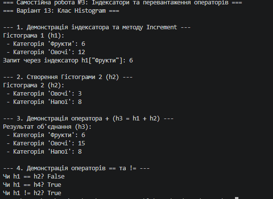

# Самостійна робота №3: Індексатори та перевантаження операторів
**Варіант 13: Клас Histogram (Гістограма)**

## Короткий опис
У даній самостійній роботі реалізовано клас `Histogram` на основі `Dictionary<string, int>`.
* **Індексатор `this[string category]`:** для читання та запису значення лічильника категорії.
* **Метод `Increment(string category)`:** для збільшення кількості в категорії на 1.
* **Оператор `+`:** об'єднання двох гістограм (додавання кількостей для однакових категорій).
* **Оператори `==` та `!=`:** порівняння вмісту двох гістограм.

## Результат виконання програми

## Відповіді на контрольні запитання
1. **Що таке індексатор і для чого він використовується:**
   Це спеціальний член класу, який дозволяє звертатися до об'єкта як до колекції за допомогою синтаксису `obj[index]` або `obj[key]`.

2. **Яка різниця між індексатором та звичайною властивістю:**
   Звичайна властивість має власне ім'я та не приймає параметрів доступу, а індексатор оголошується з ключовим словом `this` та обов'язково приймає параметр індексу в квадратних дужках `[key]`.

3. **Які оператори можна перевантажувати в C#:**
   Унарні (`+`, `-`, `!`, `++`, `--`), бінарні (`+`, `-`, `*`, `/`, `%`) та оператори порівняння (`==`, `!=`, `<`, `>`, `<=`, `>=`).

4. **Чому при перевантаженні `==` та `!=` необхідно перевизначати `Equals()` та `GetHashCode()`:**
   Це забезпечує однакову та правильну поведінку порівняння об'єктів у всій системі .NET, зокрема під час роботи з хеш-колекціями (`HashSet`, `Dictionary`), які спираються саме на `GetHashCode()` та `Equals()`.

5. **Як індексатори підвищують читабельність коду:**
   Вони надають більш лаконічний та природний синтаксис для доступу до даних об'єкта (наприклад, `histogram["Овочі"]` замість `histogram.GetCountByCategory("Овочі")`).

## Висновок
Під час виконання роботи опановано створення індексаторів, перевантаження операторів та перевизначення методів порівняння об'єктів у мові C#.