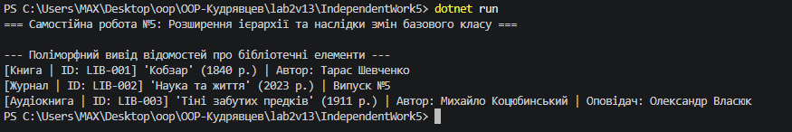

# Самостійна робота №5: Розширення ієрархії та наслідки змін базового класу

## Короткий опис
У цій самостійній роботі досліджено вплив зміни сигнатури конструктора базового класу `LibraryItem` на похідні класи `Book`, `Journal` та `AudioBook`.

### Структура ієрархії:
* **`LibraryItem` (Базовий клас):** містить поля `_uniqueId`, `_title`, `_publicationYear` та віртуальний метод `DisplayDetails()`.
* **`Book` (успадковується від `LibraryItem`):** додає поле `_author` та перевизначає `DisplayDetails()`.
* **`Journal` (успадковується від `LibraryItem`):** додає поле `_issueNumber` та перевизначає `DisplayDetails()`.
* **`AudioBook` (успадковується від `Book`):** додає поле `_narrator` та розширює `DisplayDetails()`.

## Результат виконання програми

## Аналіз наслідків модифікації базового класу
Після додавання обов'язкового поля `_uniqueId` у конструктор базового класу `LibraryItem(string uniqueId, string title, int publicationYear)` компілятор повідомив про помилку в усіх похідних класах (`Book` та `Journal`).

### Причина виникнення помилок:
Конструктор похідного класу обов'язково повинен викликати конструктор базового класу за допомогою ключового слова `base(...)`. Оскільки сигнатура базового конструктора змінилася (додався параметр `uniqueId`), усі похідні класи були змушені оновити власні конструктори та передати новий параметр у виклик `base(...)`.

Це явище відоме як **Fragile Base Class Problem (проблема крихкого базового класу)**, коли зміна базового класу призводить до каскадних змін в усій ієрархії наслідування.

---

## Відповіді на контрольні запитання

1. **Як зміна конструктора базового класу вплинула на похідні класи:**
   Усі похідні класи (`Book`, `Journal`, `AudioBook`) перестали компілюватися до тих пір, поки їхні конструктори не були модифіковані для прийняття та передачі нового аргументу `uniqueId` у виклик `base(...)`.

2. **Чим відрізняється розширення ієрархії через новий похідний клас від модифікації наявного базового класу:**
   - **Розширення (новий клас, наприклад `AudioBook`):** додає новий функціонал без зміни існуючого коду (дотримується принцип Open/Closed Principle — OCP).
   - **Модифікація базового класу (`LibraryItem`):** може зламати сумісність із наявними похідними класами та вимагає редагування конструкторів по всій ієрархії.

3. **У яких випадках для цієї задачі композиція могла б бути кращою за наслідування:**
   Якщо елемент може одночасно мати декілька форм (наприклад, одна й та сама книга існує і в друкованому, і в аудіоформаті), наслідування створює жорстку прив'язку. За допомогою композиції можна було б створити клас `LibraryItem`, який містить список компонентів або характеристик (наприклад, `AudioContent`, `PrintContent`), що робить систему гнучкішою.

4. **Як поліморфний виклик `DisplayDetails()` допомагає перевірити правильність ієрархії:**
   Дозволяє зберігати об'єкти `Book`, `Journal` та `AudioBook` у єдиному списку `List<LibraryItem>` та викликати `item.DisplayDetails()`, отримуючи правильну, деталізовану інформацію для кожного конкретного типу завдяки механізму dynamic binding (пізнього зв'язування).

## Висновок
Під час виконання роботи проаналізовано зв'язаність між базовими та похідними класами при наслідуванні, розширено ієрархію новим класом `AudioBook` та досліджено практичне застосування поліморфізму в C#.