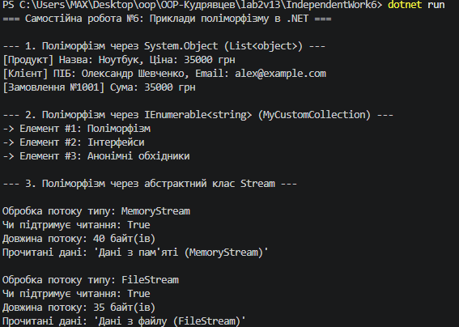

# Самостійна робота №6: Приклади поліморфізму в .NET

## Короткий опис
У цій самостійній роботі досліджено прояви поліморфізму на трьох базових рівнях платформи .NET:

1. **Базовий клас `System.Object`:** створення власної колекції `List<object>` та динамічний виклик перевизначеного методу `ToString()` для об'єктів різних класів (`Product`, `Customer`, `Order`).
2. **Інтерфейс `IEnumerable<T>`:** створення власного класу колекції `MyCustomCollection`, який реалізує `IEnumerable<string>` та дозволяє проводити уніфікований перебір елементів через цикл `foreach`.
3. **Абстрактний клас `System.IO.Stream`:** створення поліморфного методу `ProcessStream(Stream stream)`, який однаково успішно обробляє як потоки пам'яті (`MemoryStream`), так і файлові потоки (`FileStream`).

## Результат виконання програми

## Відповіді на контрольні запитання

1. **Як поліморфізм проявляється при роботі з `List<object>`:**
   Оскільки будь-який тип у C# успадковується від `System.Object`, ми можемо зберігати об'єкти різних типів у єдиній колекції `List<object>`. Під час виклику `obj.ToString()` у циклі C# використовує механізм пізнього зв'язування (dynamic binding) і викликає відповідну перевизначену версію `ToString()` саме того об'єкта, який фактично лежить у пам'яті.

2. **Що потрібно реалізувати в `MyCustomCollection`, щоб її можна було перебирати через `foreach`:**
   Клас повинен реалізовувати інтерфейс `IEnumerable` (або `IEnumerable<T>`) та мати метод `GetEnumerator()`, який повертає об'єкт-ітератор `IEnumerator`, здатен рухатися по елементах через `MoveNext()` та отримувати поточне значення через `Current`.

3. **Чому метод `ProcessStream(Stream stream)` є прикладом поліморфної роботи з абстрактним класом:**
   Метод приймає параметром базовий абстрактний клас `Stream`, оперуючи лише загальним контрактом (методи `Read()`, властивості `Length`, `CanRead`). Він не знає конкретної реалізації (файл, мережа, пам'ять), але завдяки поліморфізму правильно виконує операції читання для будь-якого спадкоємця `Stream`.

4. **Які переваги дає єдиний інтерфейс роботи для різних типів потоків і колекцій:**
   - **Слабке зв'язування (Low Coupling):** код бізнес-логіки залежить від абстракцій, а не від конкретних реалізацій.
   - **Гнучкість та розширюваність:** новий тип потоку чи колекції можна передати в існуючий метод без переписання самого методу.
   - **Повторне використання коду:** зменшення дублювання та спрощення юніт-тестування (можливість замінити реальний `FileStream` на `MemoryStream` у тестах).

## Висновок
Під час виконання роботи проаналізовано та практично підтверджено застосування поліморфізму через базові типи, інтерфейси та абстрактні класи у стандартній бібліотеці .NET.