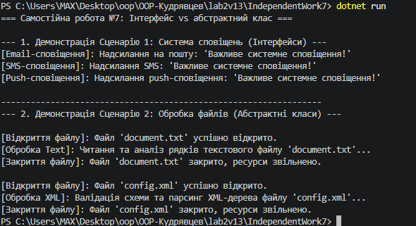

# Самостійна робота №7: Інтерфейс vs абстрактний клас — практичні критерії

## 1. Сценарій 1: Система сповіщень
### Обраний підхід: Інтерфейс `INotifier`

### Обґрунтування вибору:
1. **Відсутність спільного стану/коду:** Канали сповіщень (`EmailNotifier`, `SmsNotifier`, `PushNotifier`) не мають спільного стану чи спільних методів реалізації. Вони об'єднані лише спільним контрактом `Send(string message)`.
2. **Множинне наслідування поведінки:** У C# клас може реалізовувати кілька інтерфейсів (наприклад, `INotifier` та `ILogger`). Використання абстрактного класу заблокувало б можливість успадкування від іншого базового класу.
3. **Слабке зв'язування:** Клієнтський код залежить лише від абстрактного контракту `INotifier`, що полегшує тестування (mocking) та додавання нових типів сповіщень.

---

## 2. Сценарій 2: Обробка файлів
### Обраний підхід: Абстрактний клас `FileProcessor`

### Обґрунтування вибору:
1. **Повторне використання коду (DRY):** Процес обробки будь-якого файлу має однакові обов'язкові кроки (відкриття файлу, закриття файлу, збереження шляху `FilePath`). Ці кроки винесені у базовий абстрактний клас, щоб уникнути дублювання.
2. **Паттерн "Шаблонний метод" (Template Method):** Метод `Process()` у базовому класі задає чіткий каркас алгоритму (`OpenFile() -> ProcessContent() -> CloseFile()`), а конкретні спадкоємці перевизначають лише унікальну частину `ProcessContent()`.
3. **Чітка зв'язаність (IS-A):** Обробники `TextFileProcessor` та `XmlFileProcessor` є концептуально єдиними сутностями типу "Обробник файлу".

---

## Результат виконання програми

---

## Відповіді на контрольні запитання

1. **Які ознаки підказують, що сценарій краще моделювати через інтерфейс:**
   - Сутності належать до різних ієрархій або не мають спільної сутності-предка.
   - Потрібно задати лише чисто контрактну поведінку ("що вміє робити об'єкт") без збереження стану.
   - Потрібна підтримка реалізації кількох рольових моделей (множинна поведінка).

2. **У чому перевага абстрактного класу для процесів зі спільними кроками виконання:**
   Він дозволяє реалізувати спільний код один раз у базовому класі (наприклад, відкриття/закриття ресурсів), гарантуючи однаковий алгоритм виконання для всіх спадкоємців та запобігаючи дублюванню коду.

3. **Як порівняння двох підходів допомагає прийняти архітектурне рішення:**
   Аналіз вимог до наявності спільного коду (DRY) проти гнучкості та множинної реалізації дозволяє обрати найменш зв'язану та найбільш підтримувану архітектуру.

4. **Яку роль у ваших прикладах відіграє поліморфізм:**
   Поліморфізм дозволяє обробляти об'єкти різних типів через єдину колекцію базового типу (`List<INotifier>` або `List<FileProcessor>`) і викликати для них відповідні методи без явного приведення типів.