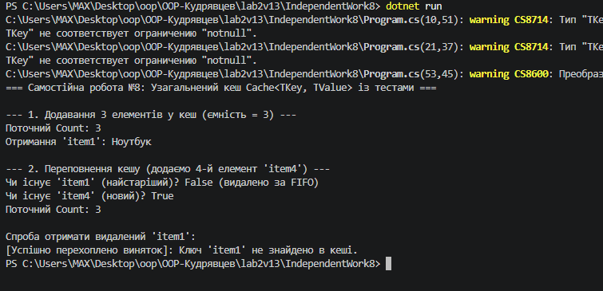

# Самостійна робота №8: Узагальнений кеш Cache<TKey, TValue> із тестами

## Короткий опис
У цій самостійній роботі розроблено узагальнений клас `Cache<TKey, TValue>` із обмеженою ємністю та політикою видалення елементів **FIFO** (First In, First Out).

### Структура рішення:
* **`Dictionary<TKey, TValue>`:** забезпечує швидкий доступ до елементів за ключем $O(1)$.
* **`Queue<TKey>`:** зберігає порядок додавання ключів для витіснення найстарішого елемента при переповненні.
* **`IndependentWork8.Tests`:** проєкт на базі `xUnit`, який тестує методи `Add`, `Get`, `ContainsKey`, властивість `Count`, витіснення за FIFO та викидання `KeyNotFoundException`.

## Результати тестування (`dotnet test`)

---

## Відповіді на контрольні запитання

1. **Переваги `Cache<TKey, TValue>` порівняно з окремими неузагальненими реалізаціями:**
   - **Типобезпечність (Type Safety):** гарантує перевірку типів під час компіляції.
   - **Продуктивність:** відсутність операцій упаковки/розпаковки (boxing/unboxing) при роботі зі значущими типами.
   - **Універсальність:** один і той самий клас працює з довільними парами типів (`string, string`, `int, MyClass`).

2. **Чому для реалізації FIFO зручно поєднувати `Dictionary<TKey, TValue>` з `Queue<TKey>`:**
   `Dictionary` дає миттєвий пошук та отримання значень за ключем $O(1)$, а `Queue` зберігає чіткий хронологічний порядок додавання ключів. Метод `Dequeue()` дозволяє за $O(1)$ отримати найстаріший ключ для видалення зі словника при досягненні ліміту `_capacity`.

3. **У яких випадках метод `Get` має викидати `KeyNotFoundException`, а коли краще `TryGetValue`:**
   Метод `Get` розрахований на суворий контракт, де відсутність ключа вважається винятковою ситуацією (`KeyNotFoundException`). Метод `TryGetValue` краще використовувати для перевірки наявності даних без генерації витратних винятків, коли відсутність ключа є передбачуваним сценарієм.

4. **Які тести є критично важливими для перевірки політики витіснення:**
   - Тест на додавання елементів понад ємність (`_capacity`).
   - Тест на перевірку, що витісняється саме перший доданий елемент (`First In`).
   - Тест на збереження правильності властивості `Count` після видалення елементів.