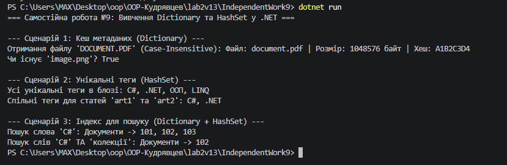

# Самостійна робота №9: Вивчення Dictionary<TKey, TValue> та HashSet<T> у бібліотеках .NET

## 1. Аналіз використання у відкритих проєктах (Open-Source)

### Приклад 1: `Dictionary<TKey, TValue>` у .NET Runtime (`System.Text.Json`)
- **Посилання:** [JsonSerializerOptions.cs на GitHub](https://github.com/dotnet/runtime/blob/main/src/libraries/System.Text.Json/src/System/Text/Json/JsonSerializerOptions.cs)
- **Контекст:** Кешування конвертерів типом (`Type` $\rightarrow$ `JsonConverter`).
- **Чому обрано:** Під час серіалізації тип об'єкта шукається дуже часто. `Dictionary` забезпечує пошук за $O(1)$, у той час як `List` вимагав би лінійного перебору $O(N)$.
- **Складність:** Пошук та додавання — $O(1)$ в середньому.

### Приклад 2: `HashSet<T>` у Newtonsoft.Json
- **Посилання:** [JsonSerializerInternalReader.cs на GitHub](https://github.com/JamesNK/Newtonsoft.Json)
- **Контекст:** Відстеження оброблених об'єктів для виявлення циклічних посилань (Circular Reference Detection).
- **Чому обрано:** Необхідно миттєво перевіряти, чи даний посилання на об'єкт вже оброблялося. `HashSet.Add(obj)` повертає `false`, якщо елемент вже присутній, забезпечуючи перевірку за $O(1)$.
- **Складність:** Перевірка наявності та додавання — $O(1)$.

### Приклад 3: Комбінований `Dictionary<TKey, HashSet<TValue>>` у AutoMapper
- **Посилання:** [TypeMapRegistry.cs на GitHub](https://github.com/AutoMapper/AutoMapper)
- **Контекст:** Збереження правил маппінгу типом джерела та множиною дозволених цільових типів.
- **Чому обрано:** `Dictionary` дає миттєвий доступ до джерела за $O(1)$, а внутрішній `HashSet` запобігає дублюванню типів призначення та дозволяє швидке виконання операцій об'єднання/перетину.

---

## 2. Порівняльна таблиця складності операцій

| Операція | List<T> | Dictionary<TKey, TValue> | HashSet<T> | Коли використовувати |
| :--- | :---: | :---: | :---: | :--- |
| **Додавання** | $O(1)$ | $O(1)$ | $O(1)$ | `List` — в кінець; `Dictionary`/`HashSet` — у хеш-таблицю. |
| **Пошук за значенням** | $O(N)$ | $O(N)$ | $O(1)$ | `HashSet` є оптимальним для унікальних елементів. |
| **Пошук за ключем** | N/A | $O(1)$ | N/A | `Dictionary` для асоціативних масивів ключ-значення. |
| **Видалення** | $O(N)$ | $O(1)$ | $O(1)$ | `List` зміщує елементи; хеш-таблиці видаляють за $O(1)$. |
| **Перевірка наявності**| $O(N)$ | $O(1)$ (`ContainsKey`) | $O(1)$ (`Contains`) | `HashSet` / `Dictionary` запобігають $O(N)$ скануванню. |

---

## 3. Результати роботи програми

---

## 4. Відповіді на контрольні запитання

1. **Переваги generic-колекцій над неузагальненими структурами даних у .NET:**
   - **Типобезпечність:** помилки узгодження типів відловлюються на етапі компіляції.
   - **Продуктивність:** відсутність операцій упаковки/розпаковки (boxing/unboxing) при роботі зі значущими типами (`int`, `DateTime`).

2. **Коли доцільніше використовувати `Dictionary`, а коли `HashSet`:**
   - `Dictionary<TKey, TValue>` застосовують, коли дані мають форму пар "ключ-значення" (наприклад, ID $\rightarrow$ Об'єкт, ім'я $\rightarrow$ метадані).
   - `HashSet<T>` використовують, коли потрібна унікальність елементів та миттєва перевірка їх наявності чи виконання теоретико-множинних операцій (`UnionWith`, `IntersectWith`, `ExceptWith`).

3. **Вплив `IEqualityComparer<T>` на коректність і продуктивність:**
   Він задає кастомну логіку обчислення `GetHashCode()` та порівняння `Equals()`. Продуктивність залежить від рівномірності розподілу хеш-кодів (мінімізація колізій), а коректність — від дотримання правила: якщо `Equals(a, b) == true`, то їх хеш-коди обов'язково повинні збігатися.

4. **Чому інвертований індекс зручно будувати на базі `Dictionary<string, HashSet<int>>`:**
   - `Dictionary` дає доступ до множини документів за словом за $O(1)$.
   - `HashSet<int>` гарантує унікальність ID документів і дозволяє за допомогою `IntersectWith` проводити миттєвий складний пошук документів, що містять одночасно декілька слів.