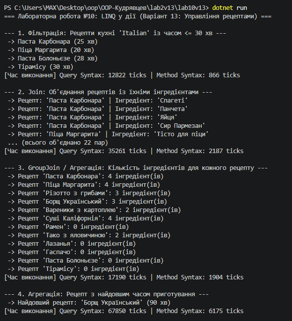

# Лабораторна робота №10: LINQ в дії: фільтри, join, агрегації. Продуктивність
**Варіант 13: Управління рецептами**

## Короткий опис
У цій лабораторній роботі реалізовано обробку колекцій об'єктів `Recipe` та `Ingredient` за допомогою LINQ. Для кожного із чотирьох завдань застосовано два підходи: **Query Syntax** та **Method Syntax**, а також проведено вимірювання часу виконання за допомогою класу `System.Diagnostics.Stopwatch`.

### Реалізовані запити:
1. **Фільтрація:** пошук рецептів кухні "Italian" із часом приготування $\le 30$ хвилин.
2. **Об'єднання (`Join`):** з'єднання рецептів із відповідними інгредієнтами.
3. **Групування та агрегація (`GroupJoin`):** підрахунок кількості інгредієнтів для кожного рецепту.
4. **Пошук максимуму:** визначення рецепту з найдовшим часом приготування (`PrepTimeMinutes`).

## Результат виконання програми

## Висновки щодо продуктивності
- **Query Syntax vs Method Syntax:** На рівні C# компілятора Query Syntax транслятором C# перетворюється на відповідні ланцюжки Method Syntax. Різниця в часі виконання між ними є незначною та перебуває в межах похибки вимірювання.
- **Найдорожчі операції:** Операції `Join` та `GroupJoin` є більш витратними за часом, оскільки вимагають порівняння ключів двох колекцій ($O(N \times M)$ без хешування або $O(N + M)$ з побудовою хеш-таблиці). Фільтрація (`Where`) є найшвидшою операцією ($O(N)$).

---

## Відповіді на контрольні запитання

1. **Різниця між синтаксисом запитів (Query Syntax) та синтаксисом методів (Method Syntax) у LINQ:**
   - **Query Syntax:** схожий на SQL (`from ... where ... select`), легше читається при складних операціях `join` та `group by`.
   - **Method Syntax:** спирається на розширюючі методи та лямбда-вирази (`.Where()`, `.Select()`). Дозволяє використовувати методи, відсутні в Query Syntax (наприклад, `.Take()`, `.Skip()`, `.DistinctBy()`).

2. **Призначення операцій `Join` та `GroupJoin`:**
   - `Join`: виконує класичне внутрішнє об'єднання (Inner Join) двох колекцій за ключем, повертаючи плоский список пар елементів.
   - `GroupJoin`: виконує об'єднання типу Left Outer Join, повертаючи для кожного елемента першої колекції згруповану колекцію відповідних елементів з другої.

3. **Приклади агрегуючих операцій LINQ:**
   - `Sum()` — обчислення суми елементів.
   - `Average()` — обчислення середнього значення.
   - `Count()` — підрахунок кількості елементів.
   - `Min()` / `Max()` — пошук мінімального або максимального значення.
   - `Aggregate()` — кастомна агрегація за заกำหนดченою акумулюючою функцією.

4. **Вимірювання продуктивності LINQ-запитів та фактори впливу:**
   Продуктивність вимірюється за допомогою класу `System.Diagnostics.Stopwatch`. На швидкість впливають:
   - Обсяг колекції.
   - Відкладене виконання (Deferred Execution) проти негайного (`ToList()`, `ToArray()`).
   - Алгоритмічна складність операцій (`Where` $O(N)$, `OrderBy` $O(N \log N)$).
   - Виділення пам'яті під проміжні об'єкти та анонімні типи.