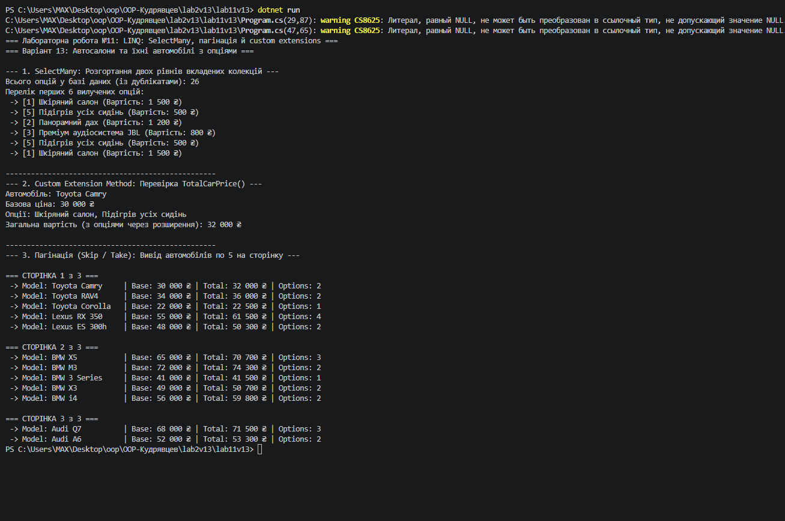

# Лабораторна робота №11: LINQ: SelectMany, пагінація й custom extensions
**Варіант 13: Автосалони та їхні автомобілі з опціями**

## Короткий опис
У цій лабораторній роботі реалізовано обробку ієрархічних вкладених колекцій `Dealership` -> `Car` -> `CarOption` за допомогою LINQ.

### Реалізовані завдання:
1. **`SelectMany`**: розгортання двохрівневої вкладеної структури для отримання єдиного плоского списку всіх опцій усіх автомобілів з усіх автосалонів.
2. **Метод розширення (Custom Extension)**: створено метод `TotalCarPrice(this Car car)`, який підраховує підсумкову ціну авто (базова ціна + сума всіх підключених опцій).
3. **Пагінація**: реалізовано посторінковий вивід списку автомобілів із використанням комбінації методів `.Skip(pageIndex * pageSize)` та `.Take(pageSize)` по 5 елементів на сторінку.

## Результат виконання програми

---

## Відповіді на контрольні запитання

1. **Для чого використовується оператор `SelectMany` та його відмінність від `Select`:**
   - `Select` здійснює стандартне проектування одного елемента в інший (повертає `IEnumerable<IEnumerable<T>>` для вкладених колекцій).
   - `SelectMany` «сплющує» (flatten) вкладені колекції у єдину плоску послідовність `IEnumerable<T>`.

2. **Реалізація пагінації даних за допомогою LINQ:**
   Пагінація реалізується за допомогою операторів `Skip()` та `Take()`:
   - `.Skip(pageIndex * pageSize)` — пропускає елементи попередніх сторінок.
   - `.Take(pageSize)` — вибирає потрібну кількість елементів для поточної сторінки.

3. **Концепція методів розширення (Extension Methods):**
   Це статичні методи в статичному класі, які використовують модифікатор `this` перед першим параметром. Вони дозволяють синтаксично "додавати" нові методи до існуючих типів без їх модифікації або успадкування.

4. **Приклад власного методу розширення:**