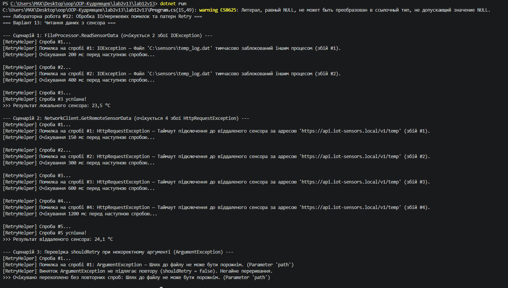

# Лабораторна робота №12: Обробка IO/мережевих помилок та патерн Retry
**Варіант 13: Читання даних з сенсора**

## Короткий опис
У роботі реалізовано відмовостійку взаємодію з файловою системою та мережевими ресурсами за допомогою патерну **Retry** та механізму експоненційної затримки:
* **`RetryHelper.ExecuteWithRetry<T>`:** узагальнений метод виконання операцій із лімітом спроб, логуванням помилок, експоненційною затримкою та фільтром винятків `shouldRetry`.
* **`FileProcessor.ReadSensorData`:** імітує тимчасове блокування файлу (`IOException`) під час перших 2 викликів та повертає `23.5` на 3-тю спробу.
* **`NetworkClient.GetRemoteSensorData`:** імітує мережевий таймаут (`HttpRequestException`) під час перших 4 викликів та повертає `24.1` на 5-ту спробу.

## Принцип роботи експоненційної затримки
Для обчислення паузи між повторними спробами використовується формула:
$$\text{Delay} = \text{initialDelay} \times 2^{\text{attempt} - 1}$$
Наприклад, при початковій затримці `150 мс` послідовність очікувань становить: `150 мс` $\rightarrow$ `300 мс` $\rightarrow$ `600 мс` $\rightarrow$ `1200 мс`. Це дозволяє зменшити навантаження на тимчасово перевантажений сервер або заблокований ресурс і дати йому час на відновлення.

## Результат виконання програми

---

## Відповіді на контрольні запитання

1. **Які типи винятків найчастіше виникають при роботі з файлами та мережею?**
   - **Файлові (IO):** `FileNotFoundException` (файл відсутній), `DirectoryNotFoundException` (неправильний шлях), `UnauthorizedAccessException` (брак прав доступу), `IOException` (файл зайнятий іншим процесом або помилка читання/запису).
   - **Мережеві:** `HttpRequestException` (помилки HTTP-запитів, недоступність хоста), `SocketException` (розрив з'єднання на рівні сокетів), `TaskCanceledException` / `TimeoutException` (перевищення часу очікування відповіді).

2. **Поясніть принцип роботи патерну Retry. Коли його доцільно використовувати?**
   Патерн **Retry** полягає в автоматичному повторному виконанні операції, яка завершилася тимчасовою помилкою (transient fault). Його доцільно використовувати при короткочасних збоях мережі, блокуванні файлів або тимчасовій недоступності зовнішніх API, але недоцільно застосовувати до логічних помилок (наприклад, невалідний формат даних чи відсутність прав доступу).

3. **Як реалізувати експоненційну затримку між повторними спробами?**
   Час очікування збільшується в геометричній прогресії залежно від номера поточної невдалої спроби: `initialDelay * Math.Pow(2, attempt - 1)` з подальшим викликом `Thread.Sleep(delay)` (для синхронного коду) або `await Task.Delay(delay)` (для асинхронного).

4. **Для чого потрібен делегат `shouldRetry` у допоміжному класі `RetryHelper`?**
   Делегат `Func<Exception, bool> shouldRetry` дозволяє відокремити тимчасові збої (`IOException`, `HttpRequestException`), які варто повторити, від критичних помилок (`ArgumentException`, `NullReferenceException`), для яких повторні спроби не мають сенсу і програму слід негайно перервати.