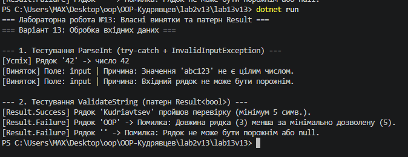

# Лабораторна робота №13: Власні винятки та патерн Result
**Варіант 13: Обробка вхідних даних**

## Короткий опис
У роботі порівняно два підходи до обробки помилок у C# на прикладі сервісу `InputProcessor`:
* **Власний виняток `InvalidInputException`:** містить контекстні властивості `FieldName` і `Reason` та використовується в методі `ParseInt(string input)`, коли порушується контракт методу (передано нечисловий рядок замість числа).
* **Патерн `Result<T>`:** реалізований із фабричними методами `Success(T)`, `Failure(string)` та `Failure(Exception)`. Використовується в методі `ValidateString(string input, int minLength)` для очікуваних перевірок користувацького вводу без витрат продуктивності на розкручування стека винятків.

## Висновок щодо доцільності вибору підходу
Для методу `ParseInt` виправданим є викидання винятку `InvalidInputException`, оскільки він зобов'язаний повернути примітивний тип `int`, а нечислове значення є винятковою ситуацією порушення формату. Натомість для `ValidateString` набагато ефективніше застосувати патерн `Result<bool>`, адже занадто короткий рядок під час введення даних користувачем — це штатний, очікуваний сценарій, який не потребує витратних блоків `try-catch`.

## Результат виконання програми

---

## Відповіді на контрольні запитання

1. **Навіщо створювати власні типи винятків? Які переваги це дає?**
   Власні винятки дозволяють точно ідентифікувати специфічну помилку бізнес-логіки у блоці `catch (CustomException)` та передавати додаткові структуровані дані (наприклад, назву поля, код помилки чи поточний баланс), а не лише текстове повідомлення.

2. **Які стандартні конструктори рекомендується реалізовувати для власних винятків?**
   - Конструктор за замовчуванням: `public MyException() { }`
   - Конструктор із повідомленням: `public MyException(string message) : base(message) { }`
   - Конструктор із внутрішнім винятком (для збереження ланцюжка помилок): `public MyException(string message, Exception inner) : base(message, inner) { }`
   - Власні перевантажені конструктори для заповнення додаткових властивостей винятку.

3. **Поясніть патерн Result. У яких випадках його використання є більш доцільним, ніж викидання винятків?**
   Патерн `Result<T>` інкапсулює результат виконання операції у вигляді об'єкта, що містить або успішне значення (`Value`), або опис помилки (`Error`) з прапорцем `IsSuccess`. Його доцільно використовувати для очікуваних бізнес-помилок (валідація форм, пошук у базі, перевірка лімітів), оскільки це робить потік керування явним і позбавляє витрат продуктивності на генерацію винятків.

4. **Які сценарії краще обробляти через винятки, а які через патерн Result?**
   - **Через винятки:** непередбачувані технічні збої, порушення інваріантів або неможливість продовжити роботу методу (втрата з'єднання з БД, відсутність критичного файлу, `ArgumentNullException`).
   - **Через патерн Result:** очікувані сценарії невдачі, які є частиною нормальної бізнес-логіки (невірний пароль, недостатня довжина рядка, товар закінчився на складі).