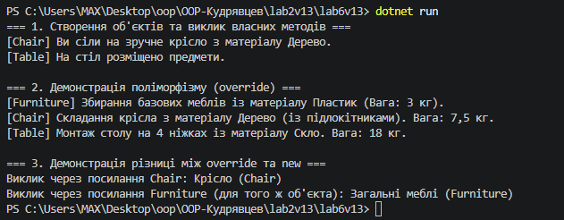

# Лабораторна робота №6: Наслідування. Ключові слова base, override, virtual. Приховування членів (new)
**Варіант 13: Ієрархія Furniture → Chair → Table**

## Короткий опис
У даній лабораторній роботі реалізовано ієрархію класів для меблів:
* **Furniture (базовий клас):** містить властивості `Material`, `Weight`, віртуальний метод `Assemble()` та метод `GetFurnitureType()`.
* **Chair (похідний клас):** успадковує `Furniture`, викликає конструктор базового класу через `base(...)`, перевизначає `Assemble()` через `override`, додає власний метод `SitOn()` та приховує метод `GetFurnitureType()` за допомогою `new`.
* **Table (похідний клас):** успадковує `Furniture`, викликає `base(...)`, перевизначає `Assemble()` та додає метод `PlaceItems()`.

## Результат виконання програми

## Відповіді на контрольні запитання
1. **Принцип наслідування в ООП та приклад з реального світу:**
   Наслідування — це механізм ООП, який дозволяє похідному класу успадковувати члени (поля, властивості, методи) базового класу, виражаючи відношення "є-різновидом" (is-a). Це сприяє повторному використанню коду. 
   *Приклад:* "Транспортний засіб" (базовий) → "Легковий автомобіль" (похідний, що має специфічні властивості, як кількість дверей).

2. **Призначення ключового слова `base`:**
   Використовується для доступу до елементів базового класу з похідного класу. Застосовується для:
   - Виклику конструктора базового класу: `public Chair(...) : base(material, weight)`.
   - Виклику методів базового класу у перевизначених методах: `base.Assemble()`.

3. **Різниця між `virtual` та `override` та забезпечення поліморфізму:**
   Модифікатор `virtual` у базовому класі дозволяє перевизначити метод у похідних класах. Модифікатор `override` у похідному класі надає нову реалізацію цього віртуального методу. Разом вони забезпечують **динамічний поліморфізм**: який саме метод виконається, визначається за фактичним типом об'єкта під час виконання програми (Runtime), а не за типом посилання.

4. **Використання модифікатора `new` для приховування членів:**
   Модифікатор `new` використовується для явного приховування члена базового класу без його перевизначення. Це створює новий метод у похідному класі з таким самим ім'ям. 
   *Наслідки:* Приховування не забезпечує поліморфізму. При виклику через посилання типу базового класу виконається метод базового класу, а при виклику через посилання типу похідного класу — прихований метод похідного класу.

## Висновок
Під час виконання роботи опановано базові принципи наслідування у C#, використання `base`, `virtual`, `override` для забезпечення поліморфізму, а також практично продемонстровано різницю між перевизначенням членів та їх приховуванням через модифікатор `new`.