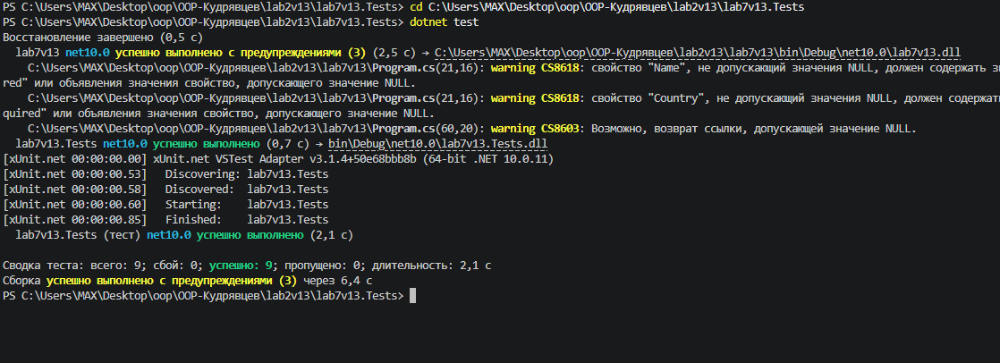

# Лабораторна робота №7: Узагальнені типи (Generics). IRepository з where-обмеженнями та тестами
**Варіант 13: Сутність City (Name, Country, Population)**

## Короткий опис
У цій лабораторній роботі реалізовано:
* **IEntity:** базовий інтерфейс сутності з властивістю `int Id { get; set; }`.
* **City:** сутність за Варіантом 13 (`Name`, `Country`, `Population`), що реалізує `IEntity`.
* **IRepository<T>:** узагальнений інтерфейс із обмеженням `where T : IEntity` та CRUD-методами (`GetById`, `GetAll`, `Add`, `Update`, `Delete`).
* **InMemoryRepository<T>:** реалізація репозиторію в пам'яті на основі `List<T>`.
* **lab7v13.Tests:** окремий тестовий проєкт xUnit із покриттям усіх методів репозиторію юніт-тестами.

## Результати тестування (dotnet test)

## Відповіді на контрольні запитання
1. **Роль where-обмежень у Generics:**
   Обмеження `where` вказують компілятору, якими саме типами може бути замінений тип-параметр `T`. Це дає доступ до властивостей та методів обмеженого типу (наприклад, `where T : IEntity` гарантує наявність властивості `Id` у будь-якого об'єкта `T`).

2. **Призначення шаблону IRepository:**
   Шаблон "Репозиторій" відокремлює логіку роботи з даними від бізнес-логіки додатка. Це дозволяє легко змінювати джерело даних (пам'ять, база даних, файл) без зміни коду, який використовує ці дані.

3. **Важливість юніт-тестів для узагальнених компонентів:**
   Оскільки узагальнені компоненти працюють із багатьма типами даних, автоматизовані тести гарантують, що вся логіка CRUD-операцій, обробка помилок (дублікати ID, відсутні елементи) та виняткові ситуації працюють стабільно та передбачувано.

4. **Проблеми, які вирішують Generics порівняно з object:**
   - **Строга типізація (Type Safety):** помилки типів виявляються на етапі компіляції.
   - **Продуктивність:** відсутні операції упаковки/розпаковки (boxing/unboxing) для значущих типів.
   - **Чистота коду:** відсутність потреби у постійній явній примусовій приведенності типів.

## Висновок
Під час виконання роботи опановано використання узагальнених типів (Generics), застосування `where`-обмежень, паттерн `Repository` та написання автоматизованих юніт-тестів за допомогою xUnit.