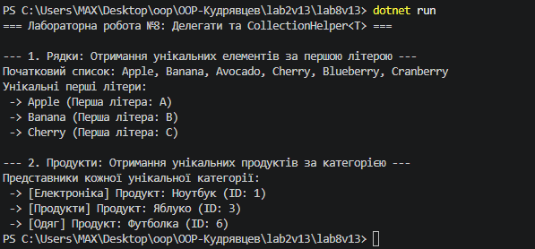

# Лабораторна робота №8: Делегати й лямбда-вирази у практиці колекцій: CollectionHelper<T>
**Варіант 13: Метод DistinctBy<T, TKey>**

## Короткий опис
У цій лабораторній роботі реалізовано узагальнений статичний клас `CollectionHelper` із власним методом `DistinctBy<T, TKey>`, який приймає колекцію `IEnumerable<T>` та делегат `Func<T, TKey> keySelector`.

Метод відбирає унікальні елементи на основі згенерованих ключів за допомогою структури даних `HashSet<TKey>` без використання готового LINQ-оператора.

У методі `Main` продемонстровано роботу методу з двома типами колекцій:
1. `List<string>` — вибір слів із унікальними першими літерами за допомогою лямбда-виразу `word => char.ToUpper(word[0])`.
2. `List<Product>` — вибір перших продуктів із кожної унікальної категорії за допомогою лямбда-виразу `p => p.Category`.

## Результат виконання програми

## Відповіді на контрольні запитання
1. **Що таке делегат і для чого він використовується:**
   Делегат — це покажчик на метод із певною сигнатурою. Він дозволяє передавати методи як параметри в інші методи, що дає змогу налаштовувати та масштабувати поведінку програмного забезпечення під час виконання.

2. **Різниця між `Func` та `Action`:**
   - `Func<T1, ..., TResult>` приймає параметри та **обов'язково повертає значення** типу `TResult`.
   - `Action<T1, ...>` приймає параметри, але **не повертає значення** (`void`).

3. **Як лямбда-вирази спрощують роботу з делегатами:**
   Лямбда-вирази надають лаконічний синтаксис для оголошення анонімних функцій (наприклад, `p => p.Category`) без потреби явно оголошувати окремі методи або класи, що робить код легшим для читання.

4. **Переваги узагальнених методів при роботі з колекціями:**
   Узагальнені методи (Generics) дозволяють написати універсальну логіку (наприклад, фільтрацію чи пошук унікальних елементів) один раз і використовувати її для будь-яких типів даних (`string`, `int`, `Product` тощо) без втрати продуктивності та безпеки типів.

## Висновок
Під час виконання роботи опановано роботу з узагальненими делегатами `Func`, лямбда-виразами та реалізацією власних методів обробки колекцій у C#.