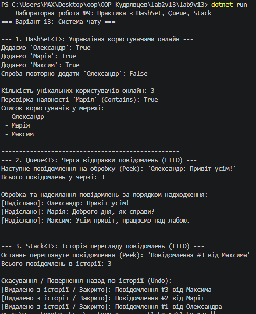

# Лабораторна робота №9: HashSet/Queue/Stack: практичні сценарії
**Варіант 13: Система чату**

## Короткий опис
У цій лабораторній роботі реалізовано систему чату з використанням трьох спеціалізованих колекцій:
* **HashSet<string> (`onlineUsers`):** зберігає унікальні нікнейми користувачів у мережі, автоматично ігноруючи повторне додавання однакових даних.
* **Queue<string> (`messageQueue`):** реалізує дисципліну FIFO (First In, First Out) для послідовного відправлення та обробки вхідних повідомлень.
* **Stack<string> (`messageHistory`):** реалізує дисципліну LIFO (Last In, First Out) для збереження історії переглянутих повідомлень та можливості їх відкату (Undo).

## Результат виконання програми

## Відповіді на контрольні запитання
1. **Різниця між `List<T>` та `HashSet<T>`:**
   - `List<T>` зберігає дублікати, підтримує індексацію та порядок елементів. Пошук елемента виконується за $O(n)$.
   - `HashSet<T>` зберігає лише унікальні значення, не гарантує порядок і не має індексації. Пошук, додавання та видалення виконуються за середній час $O(1)$.

2. **Коли доцільно використовувати `Queue<T>` замість `List<T>`:**
   Коли потрібно реалізувати чергу обробки даних за принципом "першим прийшов — першим оброблений" (FIFO), наприклад, у системах обробки замовлень, друку чи чергах повідомлень.

3. **Приклад реальної задачі, де потрібен `Stack<T>`:**
   Реалізація функції скасування дій (Undo/Redo) у текстових/графічних редакторах, кнопка "Назад" у браузері або обхід структур за допомогою алгоритму DFS.

4. **Складність операції `Contains()` для `HashSet<T>`:**
   Складність становить $O(1)$ у середньому, тому що елементи розміщуються у хеш-таблиці на основі їхнього хеш-коду (`GetHashCode()`), що дозволяє миттєво знаходити потрібний бакет.

5. **Чому `Queue<T>` називають FIFO, а `Stack<T>` — LIFO:**
   - **FIFO (First In, First Out):** перший доданий елемент виходить першим (як у реальній черзі).
   - **LIFO (Last In, First Out):** останній доданий елемент виходить першим (як у стопці тарілок).

## Висновок
Під час виконання роботи опановано використання колекцій `HashSet<T>`, `Queue<T>` та `Stack<T>`, оцінено їхню складність та практичну доцільність для різних сценаріїв C#.